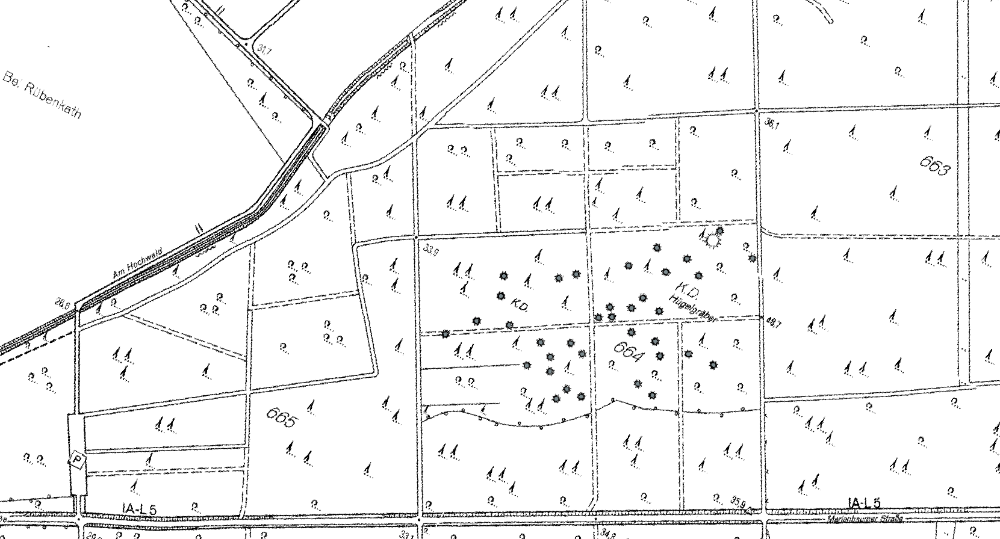

# geo1042 Homework: the burial mounds of the Uedemer Hochwald

**Tool:** QGIS (Georeferencer, digitizing, Elevation Profile) · **Time:** about 3 h at home · **Builds on:** geo0241 (georeferencing), geo0341 (digitizing), geo1041 (hillshade, profile), geo0741 (local relief model)

South-west of Marienbaum, in the forest *Uedemer Hochwald*, lies a field of burial mounds (German *Hügelgräber*). Such mound fields on the Lower Rhine are usually dated to the late Bronze Age and the early Iron Age (roughly 1200–500 BCE). An older map marks the mounds one by one as grey dots, today's basic map (ABK) only writes *Hügelgräberfeld*. You compare three sources: the old map, the terrain model and the automatic candidates of geo0741.

 
*Map extract of the Uedemer Hochwald with the burial mounds (grey dots), "K.D. Hügelgräber". © Geobasis NRW, dl-de/zero-2-0.*

## Files
| File | Use |
|---|---|
| `data/geo1042_Uedemer_Hochwald_Map_Burial_Mounds.png` | the map extract above (no coordinates) |
| your geo1041/geo0741 project `uedem.qgz` | VRT, hillshade, `lrm.tif`, `candidates` |

## Task
1. **Georeference the map extract** (*Layer → Georeferencer…*, target CRS **EPSG:25832**) with the ABK basic map (WMS) as reference: use path crossings, the corners of the forest compartments, the road *Am Hochwald* and the *Marienbaumer Straße*. At least 6 GCPs spread over the whole image. Compare *Helmert* and *Polynomial 1* (RMS, residuals) and choose one. Save the GCPs (`.points`).
2. **Digitize the mounds you see in the terrain model.** New GeoPackage layer `mounds` in `burial_mounds.gpkg` (*Point*, EPSG:25832), fields `mound_id` (text, e.g. `M01`), `diameter_m` (decimal), `height_m` (decimal), `certain` (boolean). Work with the local relief model and the hillshade (vary the illumination), one point in the centre of each mound. Measure diameter and height of at least 10 mounds with the *Elevation Profile*, estimate the rest from the local relief model.
3. **Compare with the map:** switch on the georeferenced map at 50 % opacity. How many mounds does the map show, how many did you find in the terrain model? Which mounds are missing on the map, which map dots have no mound? How far apart are map dot and mound (*Measure Line*, typical value)? Is the difference explained by your RMS from step 1?
4. **Compare with the automatic candidates of geo0741:** how many of your mounds are also candidates (*Select by Location*), how many candidates in the field are no mound? What would you change in the geo0741 recipe?
5. **Look closely:** some mounds have a small pit in the top. What could have caused it?

**Optional:** north-east of the mound field the hillshade shows faint straight banks and rectangles that are not paths. Digitize one of them as a polygon in `burial_mounds.gpkg` (layer `structures`) and suggest what it could be.

## Hand in
Report (max. 2 pages):
- GCP table summary (number of GCPs, transformation, RMS) and your choice;
- a map (layout) of the mound field: hillshade or local relief model, your `mounds` symbolised by `certain`, the georeferenced map at 50 %, scale bar, legend, sources (Geobasis NRW, dl-de/zero-2-0);
- answers to 3, 4 and 5 with numbers: count, typical diameter and height, typical offset;
- `burial_mounds.gpkg` and the `.points` file.

Deadline and channel: see the course plan.

## Tutorials
- QGIS user manual, Georeferencer: https://docs.qgis.org/latest/en/docs/user_manual/managing_data_source/georeferencer.html
- QGIS user manual, Elevation Profile: https://docs.qgis.org/latest/en/docs/user_manual/map_views/elevation_profile.html
